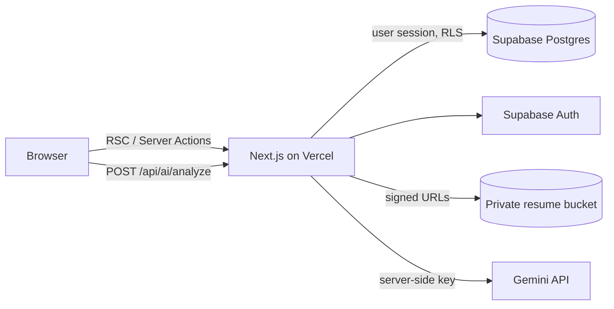

# HireFlow AI: Project Details
 
HireFlow AI is a Mini Applicant Tracking System (ATS). Recruiters manage jobs and candidates, move applications through a hiring pipeline, keep notes, and request an evidence-based AI review of a resume against a job.
 
> Internship assignment project. All bundled data is fictional.
 
---
 
## 1. Tech Stack
 
| Layer | Technology |
|---|---|
| Framework | Next.js 16 (App Router, Turbopack), React 19, TypeScript (strict) |
| Styling | Tailwind CSS 4 with CSS-variable design tokens, Plus Jakarta Sans |
| UI | Hand-written Radix-based primitives (shadcn-style), Lucide icons, Sonner toasts |
| Interaction | dnd-kit (drag and drop), motion (animation), Recharts (charts) |
| Forms | React Hook Form + Zod |
| Backend | Supabase: Postgres, Auth, Storage, Row Level Security |
| AI | Google Gemini REST API (default model `gemini-2.5-flash`) |
| PDF text | pdf-parse |
| Deploy | Vercel |

## Features
- **Auth**: Supabase email/password, session refresh in `src/proxy.ts`, every page/action re-verifies the user server-side.
- **Dashboard**: metrics, hiring funnel, applications-over-time, stage distribution, recent activity and candidates — all from SQL (`dashboard_stats` RPC). Hires are counted by entering the *Hired* stage within the period, compared against the previous equal period (no % shown when there is no baseline).
- **Candidates**: server-side search (name, email, title, skills, job), filters (stage, job, location, skill, date range), sort, pagination; create/edit/delete; private resume upload (PDF/TXT, ≤5 MB) with text extraction.
- **Candidate detail**: applications (multi-job), resume preview/download via 60-second signed URLs, notes (author-only edit/delete), activity timeline, AI panel.
- **Jobs**: CRUD, status (draft/open/closed), stage distribution, candidate list. Closed/draft jobs cannot receive applications (enforced by RLS).
- **Pipeline**: dnd-kit board with keyboard sensor, per-card stage menu, optimistic update + rollback, undo toast, server-validated transitions, rejection reason dialog, Hired/Rejected outcome columns.
- **AI analysis**: Gemini (server-side), structured JSON validated with Zod, cached by resume + job hash, hourly per-user cap, timeouts, graceful fallbacks. Output includes summary, matching skills, gaps, evidence with excerpts, experience alignment, interview questions, caveats, and a transparent *requirements alignment* band (not a probability).
- **AI Insights** page listing saved analyses.

## Stack
Next.js 16 (App Router) · React 19 · TypeScript (strict) · Tailwind CSS 4 · Radix primitives · Lucide · Motion · dnd-kit · Recharts · React Hook Form + Zod · date-fns · Sonner · Supabase (Postgres, Auth, Storage) · Gemini API.

Notes on choices: UI primitives are hand-written on Radix (shadcn-style) instead of running the shadcn CLI; TanStack Table was not needed (server-paginated tables); the Gemini REST API is called with `fetch` for easy timeouts.

## Architecture

- `src/features/*` server actions and queries · `src/lib/ai` provider, prompt, schema, alignment · `src/lib/permissions` stage rules · `src/components` UI · `supabase/migrations` schema + RLS + RPCs.
- All data access uses the **user's** session (RLS enforced). The service-role key is never used by the app, only by the local demo-user script.

## Database
`profiles` ← `jobs`, `candidates` (creators) · `applications` (candidate × job, unique pair, stage) · `candidate_notes`, `activity_logs`, `ai_analyses` (all children of `applications`, cascade delete). Activity rows are written only by `SECURITY DEFINER` triggers (clients have no insert privilege). Stage changes stamp `last_stage_changed_at` and log automatically. Indexes cover foreign keys, stage, dates and case-insensitive email/name.

## Local setup
1. `npm install`
2. Create a Supabase project. Copy `.env.example` → `.env.local` and fill the URL and anon key (and `SUPABASE_SERVICE_ROLE_KEY` for step 5 only).
3. Apply the schema: paste `supabase/migrations/20261019000001_schema.sql` into the Supabase SQL editor (or `supabase db push` with the CLI).
4. Auth → Sign In / Providers: keep Email enabled and **Allow new users to sign up ON** (needed for `/signup`). Add `http://localhost:3000/auth/callback` and your production URL under Authentication → URL Configuration. For quick demos you can turn off "Confirm email"; otherwise new users must click the emailed link.
5. Create the demo user (optional if you just use `/signup`): `npm run demo:user -- you@example.com 'strong-password' 'Demo Recruiter'`
6. Load demo data: run `supabase/seed.sql` in the SQL editor. Re-running it **resets** all demo data. (Regenerate with `npm run seed:generate`; it is deterministic.)
7. `npm run dev` → http://localhost:3000

Seeded candidates have résumé *text* (so AI analysis works) but no uploaded files; upload a PDF via Edit to try preview/download.

### AI
Set `GEMINI_API_KEY` (and optionally `GEMINI_MODEL`) in `.env.local` / Vercel. Without it, the AI button explains the missing configuration and everything else works. `AI_PROVIDER=mock` exists for future automated tests and labels results as `mock`.

## Sign-up
`/signup` lets anyone create an account (name, email, password ≥ 8). Every new account becomes a workspace member and **sees all candidates and jobs** (single-organization model), so for a real deployment set `ALLOW_SIGNUP=false` (hides the page, blocks the action) and also switch off sign-ups in Supabase, then create users via the dashboard or `npm run demo:user`. Note: seed data is attached to the first user created, but is visible to every member.

## Developer shortcut
Set `DEV_LOGIN_EMAIL` / `DEV_LOGIN_PASSWORD` in `.env.local`, run `npm run dev`, and open `/dev/login` to be signed in instantly (optionally `/dev/login?next=/pipeline`). It uses real Supabase auth, so RLS still applies, and it returns 404 outside `next dev`.

## Scripts
`npm run dev | build | start | lint | typecheck`

## Deployment (Vercel)
Import the repo, set `NEXT_PUBLIC_SUPABASE_URL`, `NEXT_PUBLIC_SUPABASE_ANON_KEY`, `GEMINI_API_KEY`. Do **not** set the service-role key. Add the Vercel domain to Supabase redirect URLs. Then walk through `DEMO.md` as a smoke test.

## Security model
- RLS on every table; membership = a row in `profiles`. Notes/activity/analyses inherit access from their application; only authors edit/delete notes.
- Resumes in a private bucket; access via short-lived signed URLs created after an RLS-checked read.
- Server-side Zod validation, stage transitions validated and compare-and-set on the previous stage.
- Resume text is untrusted: delimited in the prompt, model output is schema-validated, the model cannot write to the database, nothing is auto-rejected.
- No secrets in client code; AI key is server-only.

## Known limitations
- Single organization: any signed-in member sees all records (by design).
- Resume text extraction supports text-based PDF/TXT only (no OCR, no DOCX).
- AI rate limit is a simple per-user hourly count; no distributed limiter.
- Open sign-up gives every registrant full workspace access; disable it (`ALLOW_SIGNUP=false`) for anything beyond a demo.
- No automated tests yet; seed data does not include uploaded resume files.

## Verification status
Verified in the build sandbox: `tsc`, `eslint`, and `next build` pass (Google Fonts mocked locally because the sandbox has no access to it). **Not yet verified**: running against a real Supabase project (migration/RLS/RPC execution), live AI calls, deployment, mobile layout, accessibility audit.

## Future improvements
Playwright + unit tests, DOCX/OCR extraction, workspace/team model, command menu (⌘K), email notifications.
